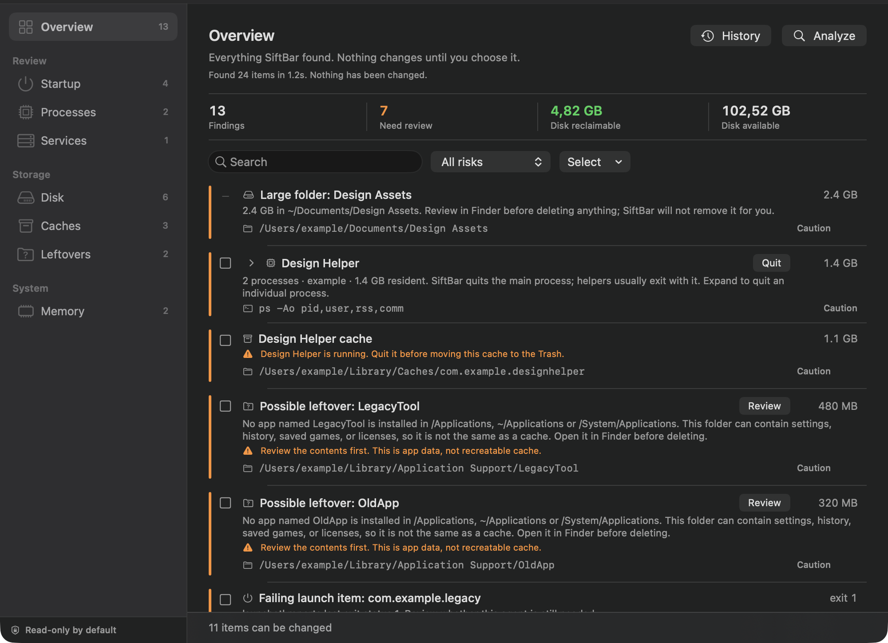
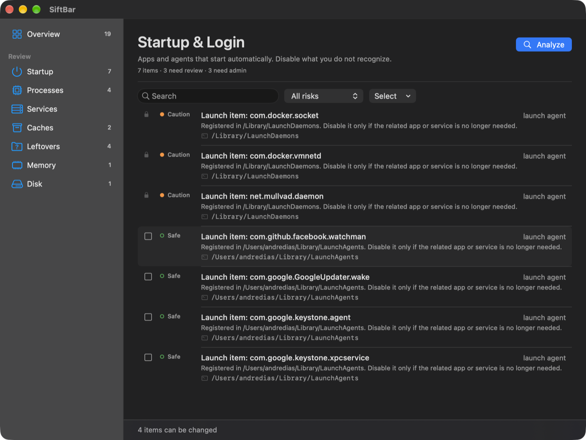
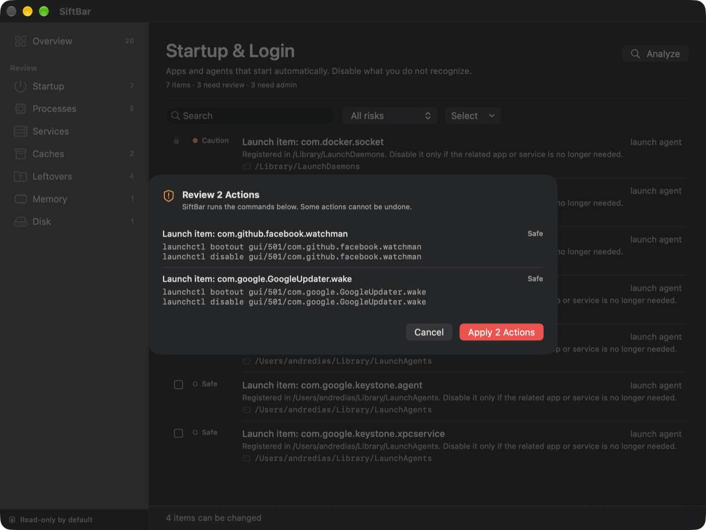
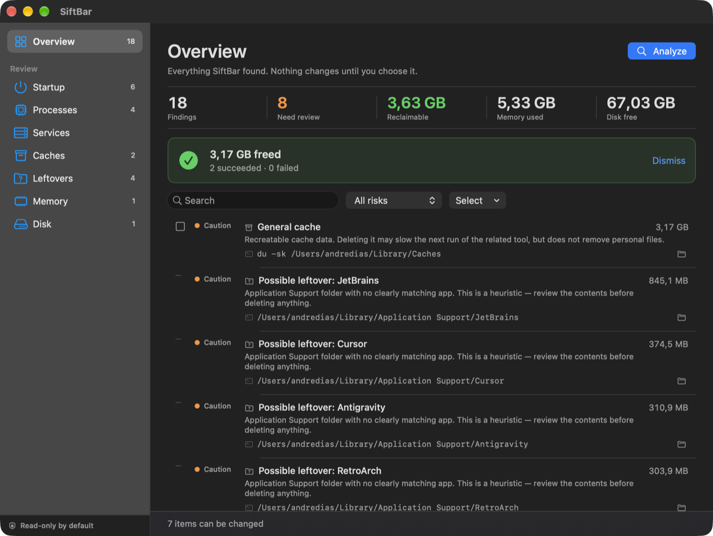

# SiftBar

[](https://github.com/andrediasgustavo/SiftBar/actions/workflows/ci.yml)
[](https://github.com/andrediasgustavo/SiftBar/releases/latest)
[](LICENSE)

**Your Mac, explained before it changes.**

SiftBar is a macOS menu bar app that shows you what is running, what starts with
your Mac, and what is taking up space — then lets you choose what to clean up.
Every finding comes with a plain-language explanation, its evidence, and the
exact command SiftBar will run. Nothing happens without your confirmation.

[**Download for macOS**](https://github.com/andrediasgustavo/SiftBar/releases/latest/download/SiftBar.dmg)
· [How it works](#how-it-works) · [Build from source](#for-developers)



## What it does

- **Startup & login items** — see the launch agents and daemons that start with
  your Mac, and disable the ones you do not recognize.
- **Heavy processes** — find the apps using the most memory and quit a single
  process when you no longer need it.
- **Caches** — reclaim space by moving recreatable cache folders to the Trash.
  SiftBar warns when a related app is still running.
- **Biggest consumers** — see the largest files and folders in Downloads,
  Desktop, Documents, Movies, Pictures, and Music, and reveal them in Finder.
- **Clear explanations** — every row shows its impact, its source, and a risk
  label (`Safe`, `Caution`, or `Dangerous`).

## How it works

1. **Analyze** — a read-only scan of memory, processes, startup items, services,
   disk, caches, and leftovers.
2. **Review** — findings are sorted by risk, so red and orange items come first.
   Search, filter by risk, and open a folder in Finder from its row.
3. **Apply** — select the items you want, review the exact commands, and
   confirm. SiftBar rescans and shows what was freed.
4. **See the result** — a result card reports reclaimed space and any failures.

## See it in action

### Every finding, explained


Each row shows the risk, the title, the impact, a short explanation, and the
source. The folder button reveals the real path in Finder.

### Startup & Login



User launch agents can be disabled. System-wide items are shown with a lock
because they require administrator rights; SiftBar will not touch them.

### Confirmation, not automation



The confirmation sheet lists the exact commands for every selected item. No
bulk "clean everything" button, no hidden actions.

### A receipt for your cleanup



*Example result after a cleanup.* SiftBar rescans and shows how much was
reclaimed, how many items succeeded, and whether anything failed.

## Safe by design

- **Read-only by default.** Analyze never changes anything.
- **No "clean everything" button.** Every action is item by item.
- **Full transparency.** The command is shown before it runs.
- **Never touches SIP-protected paths** such as `/System` and `AssetsV2`.
- **Critical processes are never actionable.** Protected system processes are
  classified as dangerous and cannot be terminated.
- **Only whitelisted cache paths can be moved to the Trash.** The executor
  checks again before acting, including path traversal and symlink escapes.
- **System-wide launch items stay locked** unless SiftBar has administrator
  support (planned, optional).
- **No account, no telemetry, no network calls.** SiftBar works locally.

## Install

1. Download the latest **[SiftBar.dmg](https://github.com/andrediasgustavo/SiftBar/releases/latest/download/SiftBar.dmg)**.
2. Open the DMG and drag **SiftBar** into **Applications**.
3. SiftBar runs in the menu bar — look for the waveform icon. There is no Dock
   icon.
4. On first launch, right-click **SiftBar** and choose **Open**, or allow it
   under **System Settings → Privacy & Security**. The build is ad-hoc signed
   and not notarized yet.

**Requirements:** macOS 13 or later on Apple Silicon.

If macOS blocks reading a protected folder, grant SiftBar **Full Disk Access**
in **System Settings → Privacy & Security**.

## Usage

1. Click the waveform icon in the menu bar.
2. Choose **Open Dashboard** (`⌘D`) or **Run Analysis** (`⌘R`).
3. Press **Analyze** and review the findings. The scan is read-only.
4. Filter by risk, search across titles/details/evidence, or use the folder
   button to reveal a path in Finder.
5. Grouped processes show a chevron; expand the row to quit a specific PID.
   Disabled launch items appear as **Disabled launch item** and can be enabled
   again.
6. Open **Disk** to see the largest files and folders in your content
   directories. They are read-only; use the folder button to review them in
   Finder.
7. Select changeable items with the checkboxes, then use the action bar at the
   bottom.
8. Review the commands and confirm. SiftBar runs them, rescans, and shows the
   result.
9. Open **History** (`⌘Y`) to see previous actions; `⌘R` runs a new analysis
   and `⌘F` focuses search.
10. Press **Quit SiftBar** (`⌘Q`) to exit.

---

# For developers

## Build from source

```bash
git clone https://github.com/andrediasgustavo/SiftBar.git
cd SiftBar
./scripts/run.sh
```

`run.sh` builds a release binary, assembles `dist/SiftBar.app`, signs it
ad-hoc, and launches it.

### Build commands

| Command | Result |
|---|---|
| `./scripts/run.sh` | Build (release), bundle, sign, and launch |
| `./scripts/run.sh debug` | Same, with an unoptimized debug build |
| `./scripts/build.sh` | Build `dist/SiftBar.app` without launching |
| `./scripts/build.sh debug` | Debug build without launching |
| `./scripts/package.sh` | Build `dist/SiftBar.dmg` from the app bundle |
| `./scripts/clean.sh` | Remove `.build/` and `dist/` |
| `swift build` | Build through SwiftPM (requires a working toolchain) |
| `swift test` | Run unit tests (requires full Xcode) |

> **Toolchain note:** the SwiftPM manifest loader in some Command Line Tools
> installations fails to link `PackageDescription`. The scripts therefore
> invoke `swiftc` directly. `Package.swift` is kept for toolchains where
> SwiftPM works normally, including the GitHub Actions runners.

### Requirements

| Requirement | Notes |
|---|---|
| macOS 13 or later | Apple Silicon only in v1 |
| Swift 5.9+ | Swift 6.x toolchains work |
| Command Line Tools | `swiftc`, `codesign`, `plutil`, `hdiutil` |
| Full Xcode | Only needed to run `swift test` locally; the app builds with Command Line Tools |

## Configuration

SiftBar is configured at build time; there is no runtime settings file yet.
Use the table below to find where each value lives.

| Setting | Default | Where to change it |
|---|---|---|
| Bundle identifier | `com.andredias.siftbar` | `Resources/Info.plist` → `CFBundleIdentifier` |
| Display name | `SiftBar` | `Resources/Info.plist` → `CFBundleDisplayName` / `CFBundleName` |
| Version | `0.1.0` (build `1`) | `Resources/Info.plist` → `CFBundleShortVersionString` / `CFBundleVersion` |
| Minimum macOS | `13.0` | `Resources/Info.plist` → `LSMinimumSystemVersion`, `Package.swift` → `.macOS(.v13)`, `scripts/build.sh` → `-target` |
| Menu bar only | enabled | `Resources/Info.plist` → `LSUIElement` |
| Build configuration | `release` | First argument to `scripts/build.sh` / `scripts/run.sh` (`release` or `debug`) |
| CPU architecture | `arm64` | `scripts/build.sh` → `-target arm64-apple-macos13.0` |
| Output location | `dist/SiftBar.app` | `scripts/build.sh` → `APP_DIR` |
| Signing | ad-hoc (`codesign -s -`) | `scripts/build.sh` → final `codesign` call; use a Developer ID for distribution |

Runtime data:

| Data | Path |
|---|---|
| History | `~/Library/Application Support/SiftBar/history.json` |
| Logs | `~/Library/Logs/SiftBar/` (planned) |

## Tests and CI

Unit tests live in `Tests/SiftBarTests/` and use XCTest. Run them with:

```bash
swift test
```

The suite has 194 tests covering command execution, every parser (`vm_stat`,
swap, `df`, `ps`, `launchctl`, `brew services`, `du`), risk thresholds,
protected-process rules, duplicate detection, grouping, per-PID children,
filtering, search, sorting, action previews, selection rules, disabled/enabled
launch labels, history storage, cleanup whitelist enforcement (including
traversal and symlink escapes), largest-consumer ranking, running-app warnings,
and a live read-only scan.

The GitHub Actions workflow at `.github/workflows/ci.yml` runs on every push
and pull request to `main`:

1. **Build and test** — `swift build`, `swift build -c release`, and
   `swift test --parallel` on `macos-15`.
2. **Validate** — shell syntax checks, `plutil -lint`, a full
   `scripts/build.sh release`, bundle structure and `LSUIElement` checks,
   `codesign --verify`, DMG packaging, and a check of the signed app inside the
   DMG. The `.app` and `.dmg` are uploaded as workflow artifacts.

Pushing a `v*` tag runs `.github/workflows/release.yml`, which builds the app,
packages the DMG, verifies it, and publishes `SiftBar.dmg` on the GitHub
Release for that tag.

## Project layout

```
Sources/SiftBar/
├── App/          # entry point, state, dashboard window
├── Core/         # models, command runner, probes, filters, executor, history
├── Collectors/   # memory, processes, startup, services, disk, caches, big consumers
├── UI/           # dashboard, rows, menu content, confirmation, history
└── Support/      # path sizing
Resources/        # Info.plist (LSUIElement = true)
Tests/            # XCTest unit tests
scripts/          # build, run, clean, package
docs/screenshots/ # README screenshots
.github/          # CI and release workflows
```

## Roadmap

| Phase | Scope | Status |
|---|---|---|
| 0 | Skeleton, menu bar, build pipeline, read-only probe | ✅ |
| 1 | Collectors: memory, processes, startup, brew, disk, caches, leftovers | ✅ |
| 2 | Risk classification, process grouping, filters, and search | ✅ |
| 3 | Safe actions with preview (processes, launchctl, brew services) | ✅ per-PID and enable; login items pending |
| 4 | Cache and disk cleanup with whitelist | ✅ |
| 5 | Optional privileged helper for system-level actions | ⏸ blocked on Developer ID |
| 6 | History, menu commands, scheduling, notifications, icon | ⏳ history and shortcuts done |
| 7 | Distribution: DMG and GitHub Releases | ✅ notarization pending |

The detailed plan, architecture, guardrails, and acceptance criteria live in
[`PLAN.md`](PLAN.md).

## Contributing

1. Create a branch from `main`.
2. Keep changes read-only by default and document any command an action runs.
3. Run `swift test` and `./scripts/build.sh` before opening a pull request.
4. Describe the behavior change and how you tested it.

## License

Released under the [MIT License](LICENSE). © 2026 André Dias.
