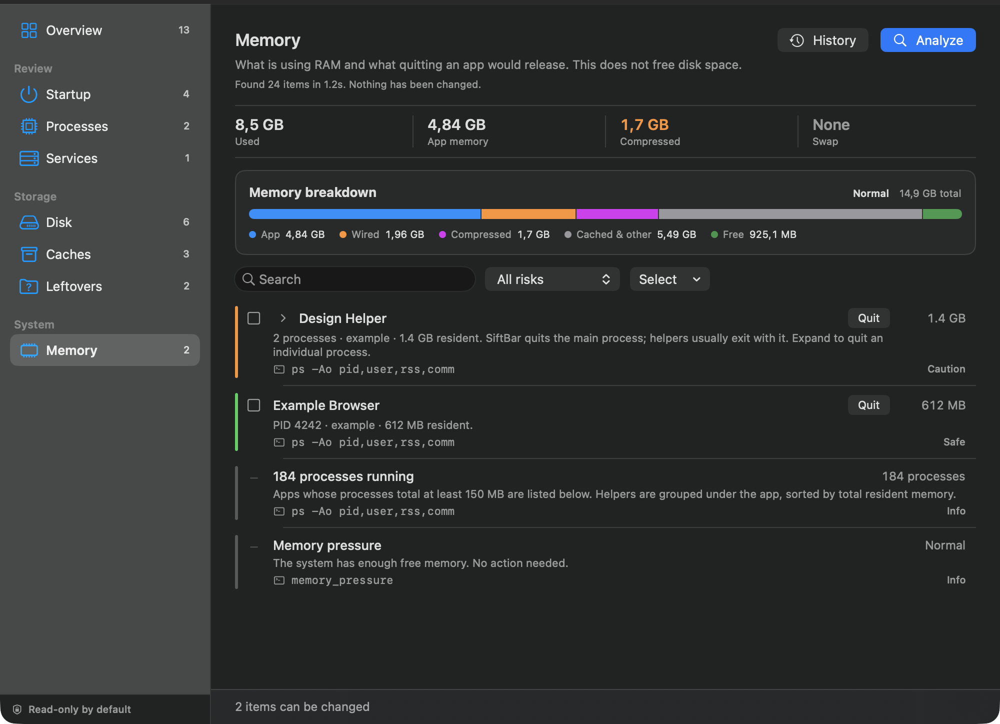
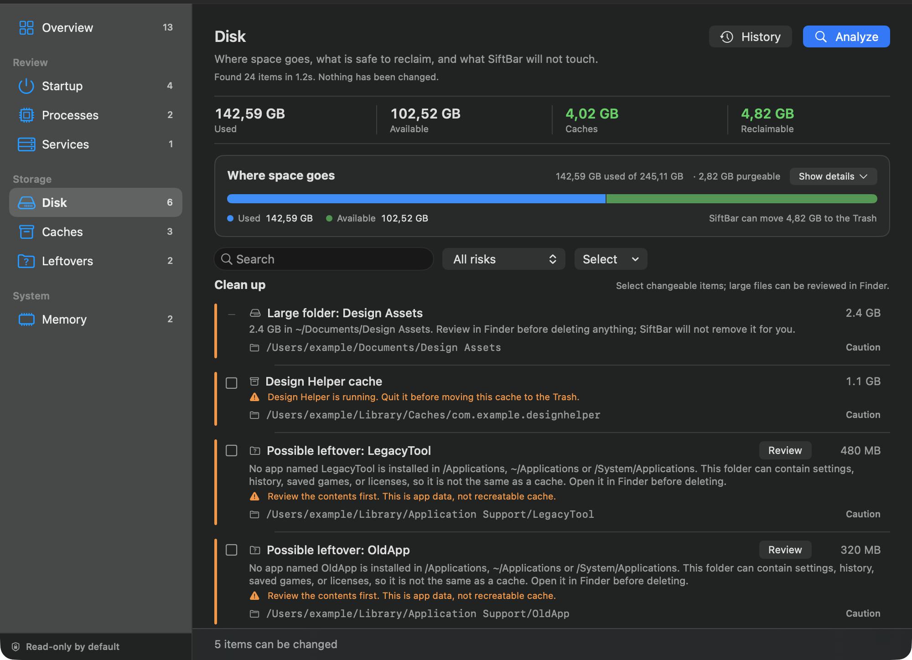
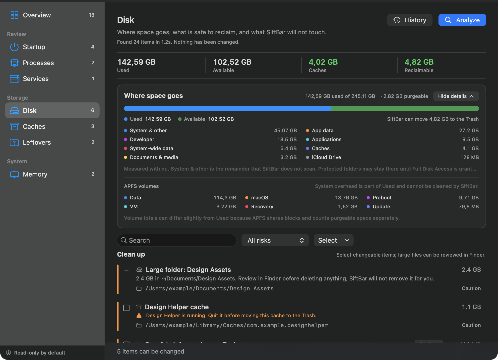
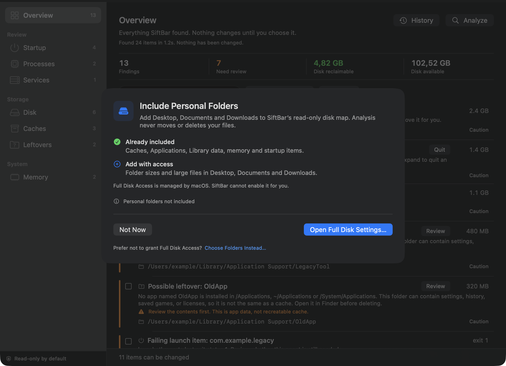

# SiftBar

[](https://github.com/andrediasgustavo/SiftBar/actions/workflows/ci.yml)
[](https://github.com/andrediasgustavo/SiftBar/releases/latest)
[](LICENSE)

**Your Mac, explained before it changes.**

SiftBar is a macOS menu bar app that shows you what is running, what starts with
your Mac, and what is taking up space — then lets you choose what to clean up.
Every finding comes with a plain-language explanation, its evidence, and the
exact command SiftBar will run. Nothing happens without your confirmation.

[**Download for macOS**](https://github.com/andrediasgustavo/SiftBar/releases/latest/download/SiftBar.dmg)


## What it does

- **Memory** — an Activity Monitor-style breakdown (app, wired, compressed,
  cached, free), swap and pressure, plus the apps using the most RAM with a
  one-click Quit. Memory numbers never get mixed with disk numbers.
- **Disk** — container-level usage that matches System Settings, a measured
  space map, APFS volume breakdown, and a **Clean up** list of caches and
  reviewed leftovers. The map collapses with **Show details / Hide details**,
  so the actionable list gets the space.
- **Startup & login items** — see the launch agents and daemons that start with
  your Mac, and disable the ones you do not recognize.
- **Heavy processes** — helpers are grouped under the app they belong to, so
  Chrome, VS Code, and Spotify appear once with their real total. Protected
  macOS processes are labelled `Protected`, excluded from the review count, and
  offer Activity Monitor instead of a dead end.
- **Caches** — one row per app cache, with a warning when the app is still
  running. Moving a cache to the Trash is transparent and reversible.
- **Leftovers** — Application Support data from apps that are no longer
  installed. SiftBar shows the size, explains that it is user data, and only
  moves it to the Trash after confirmation.
- **Biggest consumers** — see the largest files and folders in Downloads,
  Desktop, and Documents, and reveal them in Finder.
- **Clear explanations** — every row shows its impact, its source, and a risk
  label (`Safe`, `Caution`, or `Dangerous`). Informational rows are labelled
  `Info` and never counted as findings.

## How it works

1. **Analyze** — a read-only scan of memory, processes, startup items, services,
   disk, caches, and leftovers. The scan shows its four steps with live
   progress and can be stopped at any time.
2. **Review** — findings are sorted by risk, so red and orange items come first.
   Search, filter by risk, and open a folder in Finder from its row.
3. **Apply** — select the items you want, review the exact commands, and
   confirm. The item disappears from every view immediately, and SiftBar
   refreshes the numbers.
4. **See the result** — a result card separates disk bytes moved to the Trash
   from RAM released by quitting apps. Empty the Trash to actually free disk
   space.

## See it in action

### Everything in one triage list


Each row shows the risk, the title, the impact, a short explanation, and the
source. Quick actions appear where they make sense: **Quit** for an app,
**Review** for a leftover. Informational rows are labelled `Info` and protected
macOS processes are labelled `Protected`; neither counts as a finding.

### Memory, explained like Activity Monitor



The Memory tab uses the same app/wired/compressed definition as Activity
Monitor. It shows pressure, swap, a proportional breakdown, and the apps using
the most RAM with a one-click **Quit**. Memory numbers are never mixed with disk
numbers.

### Disk: where space goes and what you can clean



The Disk tab combines the space map with a **Clean up** list of caches and
reviewed leftovers, with checkboxes and command previews. **Show details /
Hide details** collapses the map so the actionable list gets more room.



Expanded, the map shows the measured folders, APFS volume breakdown, and the
part of `Used` that SiftBar will not touch. "System & other" is macOS, protected
data, snapshots and shared APFS blocks — not a cleanup target.

### Startup & Login


User launch agents can be disabled. System-wide daemons are shown with a lock
because they require administrator rights; SiftBar will not touch them.

### Confirmation, not automation


The confirmation sheet lists the exact commands for every selected item. No
bulk "clean everything" button, no hidden actions.

### A receipt for your cleanup


*Example result from synthetic demo data.* SiftBar reports disk bytes moved to
the Trash separately from RAM released by quitting apps, and reminds you to
empty the Trash to actually free the space.

### One optional permission, not a wall of prompts



macOS protects Desktop, Documents and Downloads separately. The first time you
open the dashboard, SiftBar explains what is missing and offers one optional
Full Disk Access grant. Choose **Not now** and the app keeps working with a
partial disk map; a small note in the Disk tab lets you complete access later.
No repeated folder prompts.

## Safe by design

- **Read-only by default.** Analyze never changes anything.
- **No "clean everything" button.** Every action is item by item.
- **Full transparency.** The command is shown before it runs.
- **Never touches SIP-protected paths** such as `/System` and `AssetsV2`.
- **Protected processes are never actionable.** They are labelled `Protected`,
  excluded from the review count, and offer Activity Monitor instead of a
  kill action.
- **Only whitelisted cache paths can be moved to the Trash.** The executor
  checks again before acting, including path traversal and symlink escapes.
- **System-wide launch items stay locked** because they require administrator
  rights.
- **No account, no telemetry, no network calls.** SiftBar works locally.

## Install

1. Download the latest **[SiftBar.dmg](https://github.com/andrediasgustavo/SiftBar/releases/latest/download/SiftBar.dmg)**.
2. Open the DMG and drag **SiftBar** into **Applications**.
3. Eject the DMG. SiftBar runs in the menu bar — look for the filter icon.
   There is no Dock icon.

**Requirements:** macOS 13 or later. Universal build for Apple Silicon and
Intel Macs.

### First launch: the macOS security prompt

SiftBar is **ad-hoc signed and not notarized yet**, so macOS blocks it the
first time. This is expected, and you only need to approve it once.

**macOS 15 (Sequoia) and later**

1. Open **Applications** and double-click **SiftBar**. macOS shows a warning;
   click **Done** (not **Move to Trash**).
2. Open **System Settings → Privacy & Security** and scroll down to
   **Security**.
3. Find the message about SiftBar and click **Open Anyway**.
4. Authenticate with Touch ID or your password, then click **Open** in the
   final dialog.

**macOS 13 and 14**

1. Open **Applications**, right-click **SiftBar**, and choose **Open**.
2. Click **Open** in the confirmation dialog.

After this first approval, a normal double-click opens SiftBar. Do **not**
disable Gatekeeper globally or run `spctl --master-disable`.

<details>
<summary>Advanced: removing the quarantine attribute</summary>

If the dialogs above are unavailable (for example, on a machine managed by
MDM), you can remove the quarantine flag from the app you just installed:

```bash
xattr -dr com.apple.quarantine /Applications/SiftBar.app
```

Only do this if you downloaded the DMG from this repository and trust it.
This bypasses Gatekeeper's first-launch check; it is not required for normal
installations.
</details>

### One permission instead of three

macOS protects **Desktop**, **Documents** and **Downloads** separately, so a
naive scan triggers three different permission prompts. macOS has no API to
combine them; **Full Disk Access** is the single consent that covers all three.

Without Full Disk Access, SiftBar skips those three folders. The first time
you open the dashboard it shows a one-time, optional sheet explaining what is
missing; the app keeps working normally if you choose **Not now**. A small
**Partial disk map** note stays in the Disk tab so you can complete access
later.

1. In the sheet, click **Open Full Disk Access**.
2. Enable **SiftBar** in **System Settings → Privacy & Security → Full Disk
   Access**.
3. Return to SiftBar and click **Check again**. If the permission does not take
   effect immediately, quit SiftBar from the menu bar and open it again.

Prefer not to grant Full Disk Access? Open **Other ways to grant access → Use
folder prompts instead**. macOS will then ask once per protected folder, and
SiftBar remembers your choice.

SiftBar never asks for administrator rights or runs `sudo`.

## Usage

1. Click the filter icon in the menu bar.
2. Choose **Open Dashboard** (`⌘D`) or **Run Analysis** (`⌘R`).
3. Press **Analyze**. The scan shows its progress and can be stopped; it is
   read-only. On first launch the dashboard opens on a short welcome screen
   that explains what will be inspected and offers a single **Run First
   Analysis** button.
4. Filter by risk, search across titles/details/evidence, or use the folder
   button to reveal a path in Finder.
5. Grouped processes show a chevron; expand the row to quit a specific PID.
   Disabled launch items appear as **Disabled launch item** and can be enabled
   again.
6. Open **Disk** to see the space map, APFS volumes, largest files and folders,
   and the **Clean up** list of caches and reviewed leftovers — all actionable
   from the same tab. Use **Show details / Hide details** to collapse the map
   and give the cleanup list more room; SiftBar remembers your choice. Large
   files are read-only; use the folder button to review them in Finder.
7. Select changeable items with the checkboxes, then use the action bar at the
   bottom.
8. Review the commands and confirm. SiftBar removes the items, refreshes the
   numbers, and shows the result.
9. Open **History** (`⌘Y`) to see previous actions; `⌘R` runs a new analysis
   and `⌘F` focuses search.
10. Press **Quit SiftBar** (`⌘Q`) to exit.

## Build from source

**Requirements:** macOS 13 or later, Swift 5.9+, and Command Line Tools.
Full Xcode is only needed for `swift test`.

```bash
git clone https://github.com/andrediasgustavo/SiftBar.git
cd SiftBar
./scripts/run.sh
```

`run.sh` builds a release binary, assembles `dist/SiftBar.app`, signs it ad-hoc,
and launches it.

| Command | Result |
|---|---|
| `./scripts/run.sh` | Build (release), bundle, sign, and launch |
| `./scripts/build.sh` | Build `dist/SiftBar.app` without launching |
| `./scripts/test.sh` | Run the test suite without Xcode (local fallback) |
| `./scripts/ui-smoke.sh` | Snapshot + OCR UI smoke tests (no Xcode needed) |
| `./scripts/check.sh` | Local gate: unit + UI smoke (+ XCUITest when available) |
| `./scripts/install-hooks.sh` | Install `check.sh` as the pre-commit hook |
| `./scripts/package.sh` | Build `dist/SiftBar.dmg` |
| `./scripts/clean.sh` | Remove `.build/` and `dist/` |

The interaction suite (`Tests/XCUITests/`, generated project via
`project.yml`) runs with full Xcode and XcodeGen:
`./scripts/check.sh` runs it automatically when both are installed, and CI
runs it in the `UI tests (XCUITest)` job — first run/Stop, sidebar search,
risk filter, selection + confirmation sheet, History and the result card.
Run `SIFTBAR_SKIP_HOOK=1 git commit` to bypass the pre-commit gate once.

## License

Released under the [MIT License](LICENSE). © 2026 André Dias.

---

Source code, issues, and release notes:
[github.com/andrediasgustavo/SiftBar](https://github.com/andrediasgustavo/SiftBar)
